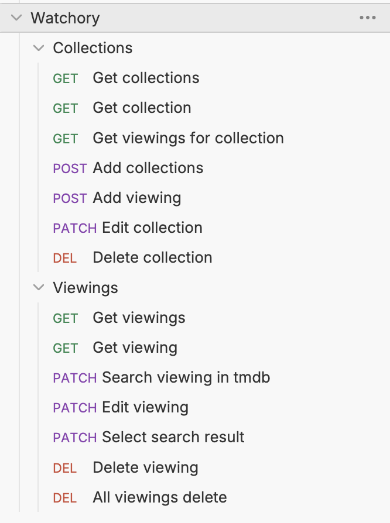

# Watchory-API
Это API для будущего приложения/веб-приложения, телеграмм бота, чего угодно для сохранения просмотренных/просматриваемых/планируемых/отброшенных фильмов/сериалов/аниме или прочтенных книг

## Возможности
* Создание коллекций 
* Создание и добавление "просмотра" в коллекцию
* Поиск произведения используя название в базе данных фильмов/сериалов/аниме/мультфильмов
* Возможность выбрать из поиска подходящий вариант для указанного произведения и применение изображения и описания из базы данных
* Редактирование "просмотра" и удаление
* Удаление коллекций и редактирование

## Стек
Python, Flask, Flask-Smorest, Flask-Sqlalchemy, marshmallow

## Как запустить

Скачать python3.10+

 ```git clone https://github.com/nanomolydev/Watchory-API.git.```

создаем виртуальное окружение:

Linux/Mac:
```
python3 -m venv .venv
source .venv/bin/activate
```

Windows:
```
python -m venv .venv
.venv\Scripts\activate.bat
```

Устанавливаем зависимости:
```pip install -r requirements.txt```

Регистрируемся в https://www.themoviedb.org и получаем [API Read Access Token](https://www.themoviedb.org/settings/api#:~:text=API%20Read%20Access%20Token)

Создаем .env по примеру .env-example

Запуск:
`flask run`

## Основные ендпоинты


### Collections (Коллекции)

| Путь                                      | Метод  | Что делает                                            |                   Примерный ввод                    | Примерный вывод                                                                                                                                                |
| ----------------------------------------- | ------ | ----------------------------------------------------- | :-------------------------------------------------: | -------------------------------------------------------------------------------------------------------------------------------------------------------------- |
| /collections                              | GET    | Получить список коллекций                             |                          -                          | [{"id":1,"name": "", "viewings": []}, {}, ..., {}]                                                                                                             |
| //collections/<int:collection_id>         | GET    | Получить конкретную коллекцию                         |                          -                          | {"id":1,"name": "", "viewings": []}                                                                                                                            |
| /collections/<int:collection_id>/viewings | GET    | Получить список "просмотров" у определенной коллекции |                          -                          | [{"collection": {...},"id": 1, "img": null, "name": "", "note": null, "overview": null, "range": 0, "status": "watching", "tmdb_searched": [],"type": "film"}] |
| /collections                              | POST   | Создать коллекцию                                     |                    {"name": " "}                    | {<br>  "id": 1,<br>  "name": " ",<br>  "viewings": []<br>}                                                                                                     |
| /collections/1/viewings                   | POST   | Создать "просмотр" в определенной коллекции           | {"name": " ", "status": "watching", "type": "film"} | {<br>  "message": "Viewing created"<br>}                                                                                                                       |
| /collections/1                            | PATCH  | Редактирование коллекции                              |                  {"name": "Test"}                   | {<br>  "id": 1,<br>  "name": "Test",<br>  "viewings": []<br>}                                                                                                  |
| /collections/1                            | DELETE | Удаление коллекции                                    |                          -                          | {<br>  "message": "Delete success"<br>}                                                                                                                        |

### Viewings ("Просмотр")

| Путь                                     | Метод  | Что делает                                                 |        Примерный ввод        | Примерный вывод                                                                                                                                                                                                                                                                                                                                                                                                                                                                                            |
| ---------------------------------------- | ------ | ---------------------------------------------------------- | :--------------------------: | ---------------------------------------------------------------------------------------------------------------------------------------------------------------------------------------------------------------------------------------------------------------------------------------------------------------------------------------------------------------------------------------------------------------------------------------------------------------------------------------------------------- |
| /viewings                                | GET    | Получить список "просмотров"                               |              -               | [<br>  {<br>    "collection": {...},<br>    "id": 1,<br>    "img": " ",<br>    "name": "",<br>    "note": null,<br>    "overview": " ",<br>    "range": 0,<br>    "status": "watching",<br>    "tmdb_searched": [],<br>    "type": "anime"<br>  },<br>  {<br>    "collection": {...},<br>    "id": 2,<br>    "img": null,<br>    "name": " ",<br>    "note": null,<br>    "overview": null,<br>    "range": 0,<br>    "status": "watching",<br>    "tmdb_searched": [],<br>    "type": "anime"<br>  }<br>] |
| /viewings/1                              | GET    | Получить определенный "просмотр"                           |              -               | {<br>  "collection": null,<br>  "id": 1,<br>  "img": null,<br>  "name": " ",<br>  "note": null,<br>  "overview": null,<br>  "range": 0,<br>  "status": "watching",<br>  "tmdb_searched": [],<br>  "type": "anime"<br>}                                                                                                                                                                                                                                                                                     |
| /viewings/1/search                       | PATCH  | Запуск поиска в TMDB по названию определенного "просмотра" |              -               | [<br>  {<br>    "id": 1,<br>    "img": " ",<br>    "overview": " "<br>  },<br>  {<br>    "id": 2,<br>    "img": " ",<br>    "overview": " "<br>  }<br>]                                                                                                                                                                                                                                                                                                                                                    |
| /viewings/1                              | PATCH  | Редактирование определенного "просмотра"                   | {"name": " ", "status": " "} | {<br>    "collection": {...},<br>    "id": 1,<br>    "img": null,<br>    "name": " ",<br>    "note": null,<br>    "overview": null,<br>    "range": 0,<br>    "status": "watching",<br>    "tmdb_searched": [],<br>    "type": "anime"<br>}                                                                                                                                                                                                                                                                |
| /viewings/1/tmdb-search-results/1/select | PATCH  | Выбор подходящего к "просмотру" варианты из поиска в TMDB  |              -               | {<br>    "collection": {...},<br>    "id": 1,<br>    "img": null,<br>    "name": " ",<br>    "note": null,<br>    "overview": null,<br>    "range": 0,<br>    "status": "watching",<br>    "tmdb_searched": [],<br>    "type": "anime"<br>}                                                                                                                                                                                                                                                                |
| /viewings/1                              | DELETE | Удаление "просмотра"                                       |              -               | {<br>  "message": "Delete success"<br>}                                                                                                                                                                                                                                                                                                                                                                                                                                                                    |
| /viewings                                | DELETE | Удаление всех "просмотров"                                 |              -               | {<br>  "message": "All viewings deleted"<br>}                                                                                                                                                                                                                                                                                                                                                                                                                                                              |
### Статусы "просмотров"

| В коде   | Означает                                       |
| -------- | ---------------------------------------------- |
| watching | Просмотр происходит сейчас / в ближайшее время |
| watched  | Просмотрено                                    |
| planned  | Просмотр планируется                           |
| dropped  | Произведение отброшено                         |

### Типы Viewings ("Просмотра")

| В коде | Означает |
| ------ | -------- |
| book   | Книга    |
| film   | Фильм    |
| anime  | Аниме    |
| course | Сериал   |
